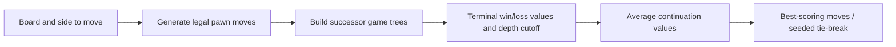

# Hexapawn Search Lab

**Small board, complete game trees, inspectable decisions.**

A Java implementation of Hexapawn with legal-move generation, immutable board
transitions, human play and a depth-limited game-tree player. It demonstrates
recursive search and evaluation on a compact, fully explorable game.



## Search policy

The evaluator averages successor values, equivalent to uniform-random
continuations below the candidate root move. Terminal outcomes score +1/-1 from
the root player's perspective; a nonterminal depth cutoff scores 0. This is an
**expected-outcome tree policy**, not adversarial minimax or a trained neural AI.

## Build and play

Requires a JDK; no external Java libraries are used. Validated with Java 21.

```bash
mkdir -p build
javac -d build src/*.java tests/*.java
java -cp build Driver 20 4 1 42
java -cp build Driver human
java -ea -cp build Checks
```

The numeric arguments are game count, White search depth, Black search depth
and tie-break seed. The first player is always White, so a depth comparison is
not a color-balanced strength benchmark. The default CLI avoids the original
1,000-match verbose run; human mode retains the interactive board display.

## Project structure

- `src/HexBoard.java`, `HexMove.java`: board rules and transitions.
- `src/GameTree.java`: recursive expected-outcome search and move selection.
- `src/AIPlayer.java`, `HumanPlayer.java`: player implementations.
- `src/Driver.java`: seeded matches and human-versus-AI play.
- `tests/Checks.java`: an independent recursive oracle over reachable positions.

## Attribution

This is a **CMSC 221 lab project**. Player code credits **Jonathan Zhang and
Zijie Mu**; board/interface scaffolding retains its existing **Duane A. Bailey**
and **Jon** author comments. The repository does not claim sole authorship of the
course framework. See [PROVENANCE.md](PROVENANCE.md), [CHANGES.md](CHANGES.md)
and [VALIDATION.md](VALIDATION.md).
